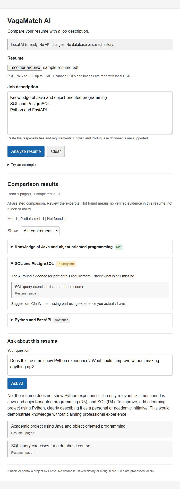

# VagaMatch AI

A basic AI-powered resume matcher built with **Python, FastAPI and local inference**.
Upload a resume, paste a job description, and review requirements alongside excerpts from the resume.

**No database. No saved history. No paid API or API key.**

> This is a small portfolio project, not a recruitment scoring system. It does not predict hiring outcomes or verify that a resume is truthful.



## Features

- Digital PDFs, scanned PDFs, PNG and JPG resumes.
- Automatic local OCR when a page has no usable text.
- Requirements grouped as **Met**, **Partially met** or **Not found**.
- Original excerpts with page numbers, assembled by the server from source references.
- Short follow-up questions about the resume and job.
- An English interface, with English or Portuguese input documents.
- Document errors distinguished from AI service errors.

## Quick start

**Requirements:** Python 3.11, internet access for the first setup, and enough memory and disk space for a local language model.

On Windows, open `iniciar.cmd` or run this command from the project folder:

```powershell
py -3.11 iniciar.py
```

Open **http://127.0.0.1:8000**. Press Ctrl+C in the terminal to stop the app.

The launcher prepares `.venv`, installs dependencies, and starts Ollama locally. On the first run it downloads the official Ollama runtime (about 1.6 GB), the language model (about 2.5 GB), and a Latin-script OCR recognition model (about 9 MB). Additional disk space is needed for extraction. Later runs reuse these files. The model is loaded before the app starts to reduce the first-analysis delay.

Runtime files and model weights are excluded from Git. The launcher verifies the runtime and OCR model checksums and disables Ollama cloud features. Once prepared, document processing does not need an internet connection. It does not set up a Windows startup task. Ollama can remain in the background; model memory is released after inactivity.

On Linux/macOS, install [Ollama](https://ollama.com/download) first, then run `python3 iniciar.py`.

### Manual setup

```powershell
py -3.11 -m venv .venv
.venv\Scripts\python.exe -m pip install -r requirements.txt
```

Then use the launcher. To start everything manually instead, install and start Ollama, prepare the models, and run:

```powershell
ollama pull qwen3:4b-instruct-2507-q4_K_M
.venv\Scripts\python.exe -c "from app.ocr_model import ensure_ocr_model; ensure_ocr_model()"
.venv\Scripts\python.exe -m uvicorn app.main:app --host 127.0.0.1 --port 8000 --no-access-log
```

## Try it

1. Open **Try an example**, download the fictional resume, and select it in the upload field.
2. Use **fill the sample job**, then select **Analyze resume**.
3. Expand a requirement to inspect its original excerpts, or filter the categories.
4. Ask a short follow-up question, such as **What evidence is missing for Python?**
5. Use **Clear** to remove the file selection, inputs and results from the page.

The included PDF is deliberately simple: Java/OOP, SQL exercises, and a web interface. It does not claim PostgreSQL, Python or FastAPI experience.

## How it works

```text
Resume PDF/image + job description
              |
      Text extraction / local OCR
              |
      Numbered source sections
              |
      Ollama selects source IDs and categories
              |
      Server resolves IDs to original excerpts
              |
      Results and conditional suggestions
```

The local model is `qwen3:4b-instruct-2507-q4_K_M`. It returns compact JSON with source references instead of rewriting quotations. A single model request is used for an analysis; there is no second repair pass or paid fallback.

The server controls the displayed excerpts and page numbers. It excludes unknown references and negative statements from positive evidence, groups duplicate requirements, and uses the more conservative category when duplicates disagree. A small check for common named technologies prevents, for example, SQL-only evidence from satisfying SQL **and** PostgreSQL. These checks do not prove semantic correctness for every requirement.

Follow-up answers are generated by the model in English, with source IDs resolved to original resume excerpts. Original excerpts retain the language of the document.

### Project structure

| Path | Purpose |
| --- | --- |
| `app/main.py` | FastAPI routes and error stages |
| `app/pdf_reader.py` | In-memory document reading, PDF rendering and OCR |
| `app/ocr_model.py` | Checksum-verified OCR model setup |
| `app/sources.py` | Source references and conservative text checks |
| `app/ai_service.py` | Compact local model requests and evidence resolution |
| `app/models.py` | Pydantic response contracts |
| `app/uploads.py` | Bounded multipart uploads without disk spooling |
| `app/static/` | Plain HTML, CSS and JavaScript interface |
| `examples/` | Fictional sample data |
| `tests/` | Automated tests with a simulated AI transport |
| `iniciar.py` | Local setup and launcher |

## API

| Endpoint | Request / response |
| --- | --- |
| `GET /api/health` | Local service and model availability; never calls a paid provider |
| `POST /api/analyze` | Multipart `resume` + `job_description`; categories, excerpts, OCR information and elapsed time |
| `POST /api/ask` | Same fields + `question`; a short answer with excerpts |
| `GET /openapi.json` | Response schemas |

Errors contain a readable `detail`. Document-reading errors have `stage: document`, model/service errors have `stage: ai`, OCR setup failures have `stage: ocr`, and job-section validation errors have `stage: job`. An AI or OCR setup error does not mean that the resume file is invalid.

## Tests and validation

```powershell
.venv\Scripts\python.exe -m pip install -r requirements-dev.txt
.venv\Scripts\python.exe -m pytest -q
```

Automated tests cover uploads, digital and scanned document paths, image inputs, OCR failures, source reference integrity, categories, negation, duplicate results, named technology checks and clear error stages. They simulate the model transport and do not require a model to be running.

Real local inference, OCR and timing checks are recorded separately in [VALIDATION.md](VALIDATION.md). Results depend on hardware, document quality and model interpretation. Test data in this repository is fictional; private resumes are not included.

## Privacy and limitations

- **No database or persistent analysis history.** Uploads, extracted text and results are not saved by the app. OCR and inference run locally.
- Model weights and technical runtime logs occupy disk. Logs do not intentionally contain uploaded document contents. Runtime/model caches may keep data in memory; clearing the page is not secure memory erasure.
- Files: PDF, PNG or JPG, up to 5 MB. PDFs: up to 10 pages. Extracted text: up to 40,000 characters. Job description: up to 12,000 characters. Questions: up to 1,000 characters.
- The AI context window may be smaller than the maximum document limits. Long inputs receive an error instead of being silently truncated.
- OCR can misread small, blurry, rotated or complex layouts. Review the displayed excerpts. Different OCR output can change the comparison.
- Valid source references prevent invented quotations; they do **not** guarantee correct classifications, complete requirement coverage, or truthful resume claims.
- No hiring score, probability, ranking or automatic qualification additions.
- Designed for a local demo on `127.0.0.1`. Public hosting, authentication and production resource isolation are outside this basic version.
- Requires local compute. The model is Apache 2.0 licensed; see the [official model page](https://ollama.com/library/qwen3:4b-instruct-2507-q4_K_M). OCR uses [RapidOCR](https://github.com/RapidAI/RapidOCR); PDF rendering uses [pypdfium2](https://pypdfium2.readthedocs.io/).

## Portfolio explanation

> I built a small FastAPI application that reads resumes, uses a local language model to compare them with jobs, and resolves source IDs to original evidence. I added OCR for scanned inputs, avoided storing uploads, and tested both the API contracts and real inference. The main trade-off is local speed and model accuracy; evidence integrity does not replace human review.

Built by [Eliese](https://github.com/lezeeee). Source: [lezeeee/vagamatch-ai](https://github.com/lezeeee/vagamatch-ai).
